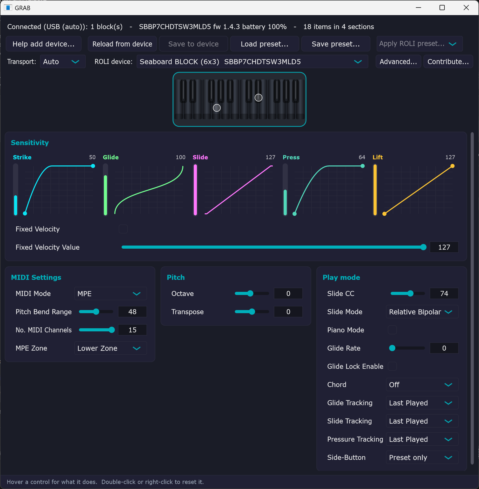

# GRAB

**GRAB** — a standalone, open tool to configure **ROLI** MPE devices directly over
MIDI SysEx, with **no dependency on ROLI Dashboard, ROLI Connect, the ROLI hardware
driver, or any login/servers.** With ROLI winding down, GRAB keeps these
instruments configurable and self-documents their protocol.

> The name nods to the devices it targets: **G**rand, **R**ise, **A**irwave,
> **B**lock (and the rest of the BLOCKS family).

<p align="center">
  
</p>

## Where it's at — v0.1.24
**Live editing** (changes write as you make them, like Dashboard), one-click **ROLI presets**
(MPE / Multi / Single / Piano), and **factory reset** for Blocks — on **Windows, macOS and
Linux**. Recent additions: a **Diagnose connection** helper for the common "port is busy / no
device found" problems; a preliminary **Seaboard GRAND** config page (it's configured with the
same protocol as the RISE); **Download firmware for archiving** (Advanced ▸ — Seaboard **Block** and every **RISE**)
while ROLI's servers are up; named **scales + native scale lighting** on the ROLI Piano; and —
with **Windows MIDI Services** — GRAB can now run **alongside your DAW** without quitting it.

**Still needed — contributions very welcome:** a full settings capture from a **Seaboard GRAND**
(to finish its config page); anonymised profiles from **LUMI Keys / Piano M, Lightpad, and
Live / Loop / Touch**; and testers for the **Linux** build. In GRAB, use **Contribute…**,
**Advanced ▸ How you can help**, or **Diagnose…** — everything is anonymised and nothing is sent
unless you click.

## Supported devices
| Device | Status |
|---|---|
| Seaboard **Block** (now sold as **Seaboard Block M**) | ✅ supported — live config read/write, ROLI presets, factory reset |
| Seaboard **RISE 2** | ✅ supported — live config read/write, ROLI presets (firmware 2.x) — own protocol |
| **ROLI Piano** (49) | ✅ confirmed (config read/write, key colours, named scales + native scale lighting; firmware 1.5.0, Windows) — same BLOCKS protocol · [PIANO.md](PIANO.md) |
| **Piano M** (24, formerly **LUMI Keys** / LUMI Keys Studio Edition — same hardware, rebranded) | ✅ confirmed (config read/write, named scales, key, colour schemes, key colours; firmware 1.3.9, macOS) — same config items as the ROLI Piano · [LUMI.md](LUMI.md). DNA-linkable, so a chained pair should show like two Seaboard Blocks once we get a report — **contributions welcome** |
| Pad & control **BLOCKS** (Lightpad/Pad, Live, Loop, Touch) · **Airwave** | ◻️ out of scope *for now* — they connect and GRAB shows their basic shared settings, but ROLI's per-app/mode config (Note Grid, Fader Block, Drum Block, …) isn't managed by GRAB (see **Scope** below). **Contributions to add them are welcome** |
| Multiple BLOCKS (DNA-connected cluster) | ✅ identical chained blocks (e.g. two Seaboard Blocks) shown as one device — shared config, writes fan out to the whole chain, drawn as one continuous keyboard |
| Seaboard **RISE 25/49** (original) | ✅ live read/write + ROLI presets — same `0x78`/RPN protocol as the RISE 2, confirmed on a RISE 25 (one caveat: min/max aren't shown — this firmware doesn't report them back) · [RISE-GRAND.md](RISE-GRAND.md) |
| Seaboard **GRAND** | 🟡 preliminary — configured with the **same `0x78` protocol as the RISE** (confirmed from a Dashboard capture): 4D (no slide), 3 pedals. Writing works via the RISE path; a page is drafted but a **full Dashboard capture is still needed** to finish the param map · [RISE-GRAND.md](RISE-GRAND.md) · [issue #6](../../issues/6) |

Got an **unsupported** device? Run GRAB, click **Help add device…** → **Run & submit** —
one click, read-only, and it's how the next devices get added.

**Scope.** GRAB focuses on ROLI's **keyboard-family instruments** — the Seaboard Block
(Seaboard Block M), Seaboard RISE / RISE 2, and ROLI Piano (with Piano M, the rebranded
LUMI Keys, a natural next addition) — where a
device's configuration is a fixed parameter set GRAB reads and writes in full. The **pad
and control BLOCKS** (Lightpad/Pad, Live, Loop, Touch) run ROLI's Littlefoot **app** system,
where each app (Note Grid, Fader Block, Drum Block, …) has its own layout and most settings
live; GRAB can read their basic shared settings but doesn't manage apps/modes, and it never
uploads programs. That's where the current scope ends — **not where it has to**: if you'd
like your block fully supported, **contributions are very welcome**. The **Help add
device…** and **Advanced…** capture tools gather exactly what's needed to start, and
[CONTRIBUTING.md](CONTRIBUTING.md) has the details.

## What GRAB is — and isn't
**GRAB is a protocol-preservation effort first, a configuration tool second.** With
ROLI winding down, the near-term goal is to reverse-engineer and *document* how these
instruments are configured over MIDI, and to gather that knowledge across the whole
device range — while the hardware and know-how are still around — so ROLI devices stay
usable whatever happens to ROLI's software and servers.

**It is:**
- An open, no-login, no-driver tool that reads and writes a device's **core settings**
  over MIDI SysEx — the things on Dashboard's config panel (5D sensitivities, MIDI
  mode/channels, pitch, tracking, play mode), generated live from what the device reports.
  **Edits write to the device as you make them** (like Dashboard), with ROLI's built-in
  **presets** (MPE / Multi / Single / Piano) one click away, and a **factory reset** for Blocks.
- A **clear, self-documenting interface** — colour-coded 5D curves (drag the end-dots to
  set min/max), grouped cards, a RISE MIDI CC fader panel, hover-help on every control, and
  double-/right-click to reset.
- A growing, community-built **map of the protocol** (the opt-in self-learn store, see
  [DEVICE-PROFILES.md](DEVICE-PROFILES.md)) and an offline **decoder** for captured traffic.

**It is *not* (yet):**
- A drop-in **replacement for ROLI Dashboard.** It deliberately does **not** flash
  firmware, upload Littlefoot programs/apps, or run custom per-key lighting (it only sets
  the device's own key colours) — and it doesn't reproduce Dashboard's full workflow.
- Finished or polished — expect rough edges. **Confirmed on real hardware: the Seaboard
  Block, the Seaboard RISE 2, and the ROLI Piano 49** so far. Other BLOCKS (Lightpad, Live,
  Loop, Touch, Piano M / LUMI, Airwave) connect and show the config they report, but **app- and
  mode-specific features aren't covered yet** (e.g. a Lightpad's Fader Block setup) — those
  need more reports. The **original Seaboard RISE** is **read/write** (same protocol as the
  RISE 2, confirmed on a RISE 25; min/max aren't shown); the **GRAND** isn't supported yet.

If you just want to tweak your device's settings today, it does that. If you'd like it to
*grow into* a fuller Dashboard alternative, that's exactly why **contributing a profile**
(one click) matters now: the more devices we capture while we still can, the better any
future tool can be.

## Quick start — download and use it (no building, no ROLI software)
You don't need to build anything or install any ROLI software — just download,
connect, and run.

1. **Download** your platform's build from the
   [**latest release**](../../releases/latest):
   - **Windows** → `GRAB-<version>-windows.zip`
   - **macOS** → `GRAB-<version>-macos.zip` (universal — Apple Silicon + Intel)
   - **Linux** → `GRAB-<version>-linux.tar.gz` (x86_64; built on Ubuntu 22.04 for wide
     compatibility) — **new, not yet tested on real hardware; feedback welcome**

   Each archive also includes the `seaprobe` / `seadecode` command-line tools.
2. **Unzip, then clear the "downloaded from the internet" flag** so the OS will open
   the unsigned app (the builds have no paid signing certificates):
   - **Windows:** right-click `GRAB.exe` → Properties → **Unblock** (or, in
     PowerShell from the folder, `Unblock-File .\GRAB.exe`), then double-click it.
     If SmartScreen still warns → **More info** → **Run anyway**.
   - **macOS:** in Terminal from the unzipped folder, `xattr -dr com.apple.quarantine GRAB.app`,
     then double-click **GRAB.app** (or right-click → **Open** the first time).
3. **Connect your device** — USB and Bluetooth both work on Windows and macOS, no
   driver needed:
   - **USB:** just plug it in.
   - **Bluetooth** (optional): on macOS, connect it once via **Audio MIDI Setup →
     Window → Show MIDI Studio → Bluetooth**; after that it's a normal MIDI port. A
     device bonds to one computer at a time, so turn Bluetooth **off** on any other
     machine that's holding it.
4. **Launch GRAB.** It auto-detects the device and shows its settings — 5D
   sensitivity curves, MIDI mode/channel, pitch, play mode, and more. Edit freely;
   **nothing is written until you click Save to device.** (If a port won't open,
   another app or leftover ROLI software is holding it — GRAB tells you.)
5. **Contribute (optional).** Click **Contribute…** to send an **anonymized**
   snapshot of what your device reports — your serial is **hashed**, never sent raw
   — so GRAB can learn and label settings for everyone. Review the exact data first,
   or **Save to file** instead.

GRAB only reads and writes the same settings ROLI Dashboard does; it **never** sends
firmware, reset, or program-upload messages (see [Safety and firmware](#safety-and-firmware)).

*Want the bleeding edge?* CI builds every commit: **Actions** tab → latest `build`
run → **Artifacts** (needs a GitHub login, expires after 90 days — prefer a release
otherwise). *Want to build or improve GRAB?* See [Building from source](#building-from-source)
and [CONTRIBUTING.md](CONTRIBUTING.md).

## Troubleshooting — my device won't connect
GRAB auto-detects on launch; the **status line at the top** says what it found. The quickest
help is the **Diagnose…** button — it lists the MIDI ports GRAB can see, flags a port that's
**held by another app**, and gives platform-specific steps. Otherwise work through whichever case
below matches, then (if it's still stuck) send a report — that's how devices get fixed and added.

**Nothing detected ("No … Seaboard found")**
- **USB:** plug the device in directly — no driver needed; try another cable/port. ROLI
  devices are class-compliant, so it should appear right away.
- Use the **Transport** dropdown (top row: Auto / USB / BLE) to force USB or BLE instead
  of Auto, then press **Reload from device**.

**Bluetooth won't connect**
- **macOS:** BLE-MIDI devices do *not* appear in System Settings → Bluetooth. Connect
  once via **Audio MIDI Setup → Window → Show MIDI Studio → the Bluetooth icon → Connect**.
  After that it's a normal MIDI port — set **Transport → BLE** (or Auto) and **Reload from device**.
- **Windows:** pair the device first in **Settings → Bluetooth & devices**. For reliable
  BLE-MIDI, use the **new Windows MIDI Services** stack — it's **built into Windows 11
  (25H2 and later)**, so keep Windows updated; on older builds install it from Microsoft's
  MIDI project ([github.com/microsoft/MIDI](https://github.com/microsoft/MIDI), or
  `winget install Microsoft.WindowsMIDIServicesSDK`). The legacy WinRT BLE-MIDI path is
  flaky by comparison.
- A ROLI device **bonds to one computer at a time** — if it won't advertise, turn
  Bluetooth **off** on any other machine (or in ROLI software) holding it, then
  power-cycle the device and try again.

**Stuck on "Connecting…" or "no BLOCKS device replied"**
A port opened but the device never answered — usually one of:
- **Another app holds the port** — ROLI Dashboard/Connect, a DAW, or another MIDI app.
  Quit it and reconnect (GRAB reports a held port rather than fighting for it).
- **Windows: ROLI's background service holds the port.** If ROLI Connect/Dashboard is
  installed, the **"ROLI Hardware Driver"** Windows service can keep the port open. Stop
  that service (or uninstall Connect) and reconnect. GRAB itself needs **no** ROLI driver.

> **Can I run GRAB alongside my DAW on Windows?** Yes — if **Windows MIDI Services** is your
> active MIDI stack. That new stack reroutes even legacy apps so MIDI ports are **no longer
> exclusive**: several apps (your DAW *and* GRAB) share one device at once. We've confirmed
> this on hardware — GRAB read and operated a Seaboard Block over USB while another app held
> the same port ([issue #7](../../issues/7)). Windows MIDI Services is built into recent
> Windows 11 builds and installable on older ones (see the Bluetooth note above) — it's the
> same stack we already recommend for reliable BLE.
>
> The old "quit everything first" rule only applies on the **legacy** Windows MIDI stack,
> which *is* single-client/exclusive (one app per port). On **macOS** (CoreMIDI) and **Linux**
> (ALSA) the MIDI layer is already multi-client, so concurrent use works there too. (By
> contrast, ROLI Dashboard sidesteps the legacy limit via its own **"ROLI Hardware Driver"**
> background service, which brokers the device; GRAB needs no such driver.)
- **It's a Seaboard RISE** — RISE uses a different protocol (GRAB shows a separate RISE
  page). The **RISE 2** and the **original RISE 25/49** are both supported (read/write);
  the **GRAND** isn't supported yet — GRAB says so in the status line; please help add it.
- Try the other **Transport** option (USB ↔ BLE).

**Connected, but a setting looks missing / unnamed / wrong** — contribute a profile
(below); the shared name map improves it for everyone.

### How to help or report — all opt-in, shown before anything is sent
Your serial, if included, is hashed (or blanked in raw MIDI and logs); each dialog also offers **Save to file** or **Open a
prefilled GitHub issue** instead of submitting.

- ⭐ **Unsupported device? Click "Help add device…"** → **Run & submit**. The easiest way
  to help: GRAB auto-picks the device's port, sends a **read-only** "who are you?"
  request, records the reply + a few seconds of what it emits, and submits it all in one
  go. **It never changes a setting.** This is the one-click path for RISE/GRAND owners.
- **Contribute a profile** — if it *did* connect, **Contribute…** → **Submit** (the config
  your device reports).
- **Advanced… menu** (for the technically-minded): **Raw MIDI capture** (log everything a
  device emits while you play; read-only) and **Active probe** (send one curated,
  documented message and log the reply — firmware/reset messages are blocked). Both can
  Submit, Save, or open a prefilled GitHub issue.

## What it does
- **Reads and writes device configuration** over USB-MIDI or BLE-MIDI — all the
  settings ROLI Dashboard exposes (5D sensitivities, MIDI mode/channels, pitch,
  tracking, pedal, …), generated from what the device reports rather than hard-coded.
- **Writes persist** to flash (plain `setConfig` — the same thing Dashboard does).
- **Live UI** — controls update as the device reports changes (from the device itself
  or another app), and the control set adapts when a setting like MIDI Mode changes
  which parameters are available — no manual refresh needed. Unsaved edits are kept.
- **JSON presets** (Seaboard Block and RISE), transport auto-select (USB/BLE).
- **Chained Seaboard Blocks** of the same type appear as one device — shared config, writes
  fan out to the whole chain, shown as a single continuous keyboard.
- **Keyboard graphic** at the top for Seaboard devices, with **live 5D-touch rings** that
  track finger position and grow with pressure.
- **Decodes the protocol offline** from hex dumps or USBPcap/Wireshark/BLE captures.

## Building from source
Windows, Visual Studio 2022/2026 + MSVC. Built with **JUCE 8** + **CMake** (no
Projucer); the code is portable and the `sea_sysex` decoder has no JUCE dependency.
macOS/Linux build the same way (CMake picks the native generator). CI builds
**Windows, universal macOS, and Linux** for every tagged release.

```sh
cmake -S . -B build -G "Visual Studio 18 2026" -A x64   # first run fetches JUCE 8
# GUI:
cmake --build build --config Debug --target GRAB
./build/GRAB_artefacts/Debug/GRAB.exe
# CLI probe / writer:
cmake --build build --config Debug --target seaprobe
./build/seaprobe_artefacts/Debug/seaprobe.exe blocks             # read config
./build/seaprobe_artefacts/Debug/seaprobe.exe set 13 64 --commit # write one value
# offline decoder:
cmake --build build --config Debug --target seadecode
./build/Debug/seadecode.exe F0 00 21 10 77 00 01 01 00 5D F7
```
`--transport usb|ble|auto` and `--serial <S>` select the transport / a specific
block. The GUI writes logs to a per-user dir (`%APPDATA%\GRAB\logs` on Windows,
`~/Library/Application Support/GRAB/logs` on macOS).

## Components
- **`GRAB`** — the desktop GUI: connection status, transport + device selectors, one
  control per device config item grouped into sections, Save to device, JSON presets.
- **`seaprobe`** — console tool: list ports, dump raw SysEx, decode topology/config,
  and the gated single-value writer (dry-run by default). `seaprobe rise2 ...` does the
  same for a Seaboard RISE 2.
- **`seadecode`** — portable (no-JUCE) offline decoder for ROLI SysEx, USB-MIDI and
  BLE-MIDI captures.
- **`libs/sea_sysex`** — the portable framing/checksum/bit-unpacking decoder library.
- **`third_party/roli_blocks_basics`** — ROLI's open BLOCKS stack, vendored and
  patched for JUCE 8 (see [PATCHES.md](PATCHES.md)).

## Documentation
- [PROTOCOL.md](PROTOCOL.md) — the observed BLOCKS SysEx protocol (framing, checksum,
  config, firmware), each fact marked confirmed-on-device vs from-source.
- [RISE-GRAND.md](RISE-GRAND.md): the Seaboard RISE 2 protocol and notes for adding the GRAND.
- [PIANO.md](PIANO.md) — ROLI Piano 49 notes: connecting on Windows + the config items it reports.
- [DEVICE-PROFILES.md](DEVICE-PROFILES.md) — the opt-in "self-learn" device-profile
  schema (contribute what your device reports, to a store at demix.me).
- [PATCHES.md](PATCHES.md) — the vendored-library patches.
- [CONTRIBUTING.md](CONTRIBUTING.md) — how to help, especially with new devices.

## Contributing — and how the "self-learn" store works
GRAB gets better the more devices people point it at. Several ways to help, all
**optional** and shown to you before anything is sent:

- ⭐ **Help add an unsupported device — one click.** If GRAB says your device isn't
  supported (RISE/GRAND), click **Help add device…** → **Run & submit**. GRAB auto-picks
  the port, sends one **read-only** identity request, records the reply + a few seconds of
  what the device emits, and submits it — **without changing any setting**. The simplest
  possible contribution.
- **Contribute a device profile** — **Contribute…** sends an **anonymized** snapshot of
  what your (supported) device reports: config items, ranges, options, values. Your
  **serial is hashed** (never sent raw); review the JSON first, or **Save to file**.
- **Dig deeper (advanced)** — the **Advanced…** menu has two optional tools: **Raw MIDI
  capture** logs everything a device emits (read-only), and **Active probe** sends one
  *curated, documented* message and logs the reply, to confirm an unsupported device's
  control protocol. Both offer Submit / Save / open-an-issue; firmware/reset/packed
  messages are hard-blocked and you must Arm before each probe send.
- **Contribute code** — the dashboard/UI and new-device support are open; open a pull
  request. RISE/GRAND is a great start ([RISE-GRAND.md](RISE-GRAND.md) / [issue #1](../../issues/1)).

**What it's for.** With ROLI winding down, the aim is to build a **community map of the
protocol** across the whole range while we still can. Submissions go to a small store at
demix.me, and GRAB then **pulls the community-learned names back** to label settings your
device reports but doesn't name — so everyone's copy of the tool gets smarter as more
people contribute. GRAB never sends audio or anything you play, and nothing it collects
identifies you. See [DEVICE-PROFILES.md](DEVICE-PROFILES.md) for the schema and the exact
data, and [CONTRIBUTING.md](CONTRIBUTING.md) to get involved.

## Safety and firmware
GRAB only sends read/config MIDI over the one selected port. It **never** sends
firmware-update, program-upload, factory-reset, or bootloader messages, and if a port
is held by another app it reports that rather than fighting for it.

On firmware specifically: GRAB **reads and reports** the version (shown in the header
and in a contributed profile) but does **not** download, flash, or distribute
firmware. ROLI's firmware is their copyrighted IP behind authenticated endpoints, and
GRAB is login-free by design. To preserve *your own* device's firmware while ROLI's
servers are still up, see [tools/FIRMWARE-CAPTURE.md](tools/FIRMWARE-CAPTURE.md) (via
your own ROLI account) — keep those binaries for yourself, out of the profile store.

## Credits
GRAB is built by the community. In particular, **[sbialy](https://github.com/sbialy)**
reverse-engineered the **Seaboard RISE 2 protocol** (the `0x78` dialect GRAB uses to read
and write RISE settings), built the **5D sensitivity-curve rendering**, and contributed the
**serial/MAC anonymization** and further RISE fixes. **[fictionfred](https://github.com/fictionfred)**
captured and decoded the **original RISE (RISE 25)** write protocol, which unlocked read/write
support for the original Seaboard RISE. Thanks also to everyone who's submitted a device profile, capture, or report — the
supported-device list grows from those. Contributions welcome; see
[CONTRIBUTING.md](CONTRIBUTING.md).

## License
MIT — see [LICENSE](LICENSE). Vendored `roli_blocks_basics` is ISC (ROLI Ltd); JUCE
is fetched at build time under its own license.
