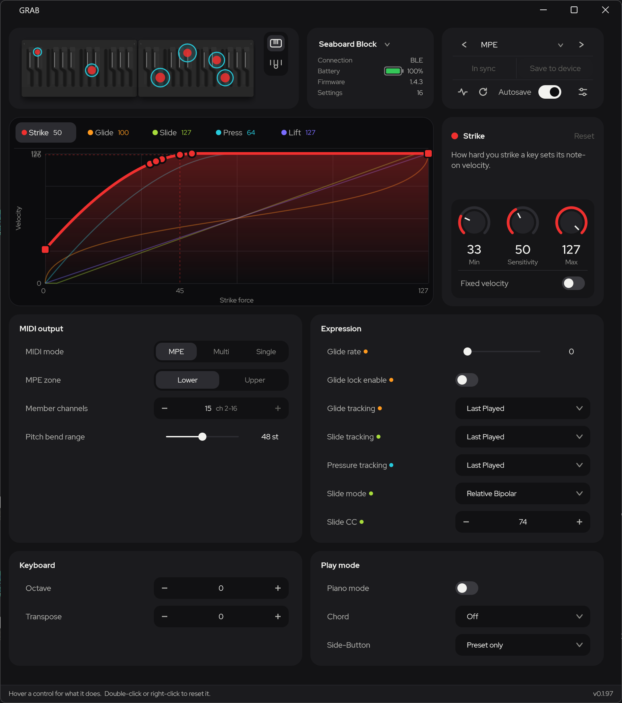

# GRAB

**GRAB** — a standalone, open tool to configure **ROLI** MPE devices directly over
MIDI SysEx, with **no dependency on ROLI Dashboard, ROLI Connect, the ROLI hardware
driver, or any login/servers.** With ROLI winding down, GRAB keeps these
instruments configurable and self-documents their protocol.

> The name nods to the devices it targets: **G**rand, **R**ise, **A**irwave,
> **B**lock (and the rest of the BLOCKS family).

<p align="center">
  
</p>

## Where it's at — v0.1.98
A **rebuilt interface (UI V2)** — a FabFilter-style studio layout designed by *fictionfred* — on top
of **live editing** (changes write as you make them, like Dashboard), a unified **Preset** menu
(ROLI presets + your own saved presets, per device), and **factory reset** for Blocks — on
**Windows, macOS and Linux**.

**New in v0.1.98 — fixes:**
- **Piano / LUMI mode cards** ([#32](../../issues/32)) — each of the four modes now shows its own
  **Color Scheme + Enable Pitch Bend + Enable Pressure** together, like ROLI Dashboard (the four
  "Enable Pressure" toggles were being pulled into the Expression card).
- **Auto-explore no longer blocks itself** ([#14](../../issues/14)) — on the legacy Windows one-app-per-port
  stack, *Help add device* can now free GRAB's own hold on the port when the probe can't open it, then
  reconnect. On Windows MIDI Services / Mac / Linux (multi-client) nothing changes. Clearer message when
  another app is holding the port.
- **RISE preview labels** — the dev preview now names the model + firmware (RISE 2 fw 2.0.2 vs original
  RISE fw 1.1.8) so it's clear the Min/Max difference is firmware-driven, not 49-vs-25-key.
- **RISE live-view Glide** — the touch ring now tracks a glide across the keys (scaled by the device's
  pitch-bend range) instead of nudging a fixed ±2 semitones, so a big glide reads like ROLI Dashboard's
  instead of looking almost stationary.

**New in v0.1.97 — a new interface (UI V2):**
- **Rebuilt settings page, FabFilter-style** (designed by *fictionfred*). One **5D sensitivity graph**
  overlays all five curves (Strike / Glide / Slide / Press / Lift), colour-coded, the selected one lit
  and editable — **drag the curve body or its square Min / Max handles**, with a dotted "default" line
  showing where it started and **live keypress dots** riding the curve as you play. The selected
  dimension's **Min / Sensitivity / Max dials** sit in their own inspector panel with a plain-English
  description of what it does.
- **Bento top band** — the device drawing (now with a soft drop shadow), a device **dropdown** over a
  battery / firmware / settings dashboard, and an **MPE / preset** card (preset switcher, Reload, Save,
  Autosave).
- **Tidied cards** — MIDI output, Expression, Keyboard, Controller CCs and the rest laid out in two
  even columns; integers as **steppers** (− / ＋), zones and modes as **segmented** pills, colours as
  wells, and every setting flagged with a dot when it differs from the device.
- **One consistent theme** — Red Hat typography, Fred's radii and colours, pill switches, and **dark
  themed dialogs** (Diagnose, Contribute, Capture MIDI, How-you-can-help) with no OS title-bar chrome.
- **Live keys / keystroke map** — play the device to see where and how hard; now wired on **RISE / GRAND**
  too, not just BLOCKS.
- *(v0.1.86–0.1.96 built this out incrementally on the `feat/track-b-zones` branch; v0.1.97 is the first
  full release of it.)*

**New in v0.1.85:**
- **Developer Control Block + Control Block presets.** GRAB now draws the **Developer** block (numbered
  caps 0–7 + −/+) — confirmed from ROLI's factory program to be a plain configurable 10-button block (every
  button defaults to MIDI CC 102–111). And the Preset menu gains two control-block layouts: **"Blank — buttons
  send CC 102–111"** (repurpose any control block as a generic MIDI controller) and **"Reset to factory
  default"** (the block re-applies its own type's layout). Save/apply your own layouts via the preset Export/Import.

**New in v0.1.84:**
- **Control Block read + write confirmed on hardware.** Contributor *moofy* verified it on a Live and a
  Loop block: editing a button's **MIDI CC, behaviour or on/off colour** in GRAB actually takes effect on
  the device. The per-button editor was decoded and math-checked before; it's now proven end-to-end. The
  only control-block gap left is a **Touch Block** (no one has one yet).

**New in v0.1.83:**
- **Soundpacks in *Archive my ROLI downloads*.** GRAB now reads ROLI Connect's owned-soundpack catalog
  (`/user/products/soundpacks`) and **downloads every soundpack your account owns — free or paid —
  directly** (each entry carries a pre-signed `.rpkg` link), on top of the apps, firmware and installed
  packages. Still download-only; already-installed packs are copied from Connect's cache rather than
  re-fetched.

**New in v0.1.82:**
- **macOS fix** for *Archive my ROLI downloads*: ROLI Connect's installer uses the `latest-mac.yml`
  manifest on macOS (not `latest.yml`), and the Connect-cache path lookup now tries both the nested and
  flat layouts. Dashboard/Equator/firmware already worked on macOS.

**New in v0.1.81:**
- **Archive my ROLI downloads** (*Advanced ▸*). A preservation grab for the whole account while ROLI's
  servers last: reads your signed-in **ROLI Connect** session (no password) and **downloads the installers
  you own** — Dashboard, Equator, Connect — plus your **device firmware**, and **copies the Studio /
  Equator 2 `.rpkg` packages Connect already fetched**. Download-only; never flashes or uploads. Browser
  hand-off offered as the tokenless path. See the expanded [preservation notes](PRESERVATION.md).

**New in v0.1.80:**
- **Call for Control Block testers.** GRAB reads and live-edits Live / Loop / Touch buttons. **Read + write
  are now hardware-confirmed on Live and Loop** (thanks to contributor *moofy*: editing a button's CC,
  behaviour or colour takes effect on the device). The only gap left is a **Touch Block** — see
  [CONTROL-BLOCKS.md](CONTROL-BLOCKS.md).

**New in v0.1.79:**
- **Windows MIDI backend reverted to WinMM.** Per Microsoft's Pete Brown ([issue #7](../../issues/7)),
  the WinRT backend tried in v0.1.75 adds **no** multi-client benefit without Windows MIDI Services (same
  limit as WinMM) and its Bluetooth path **doesn't work with most ROLI devices**. GRAB now uses plain
  WinMM: on **Windows 11 25H2+** Windows MIDI Services reroutes WinMM and makes it multi-client (share
  with your DAW) and gives working BLE; on older builds, use USB.

**New in v0.1.78:**
- **Control Blocks — Live / Loop / Touch.** GRAB now **reads and live-edits** their buttons in full:
  per-button **MIDI CC**, **behaviour** (toggle / pulse / gate / trigger / cycle / inc-dec / tri-state),
  **default / min / max**, and **on/off colours** — each button's settings and its two colours grouped
  together in one card. Each type is drawn with its real 10-button layout. Decoded from ROLI's factory
  Littlefoot program and confirmed against Live + Loop profiles — a **Touch Block** capture (and any
  control block connected on its own) is still welcome to confirm its layout.
- **Between v0.1.56 and v0.1.78:** pixel-perfect RISE/GRAND keybed and octave alignment, a consolidated
  **device-info bar** with a battery icon, and a **program-upload (sharedDataChange)** decoder. On
  **Windows 11 25H2+**, **Windows MIDI Services** (default API mode) makes MIDI multi-client, so GRAB
  (plain WinMM) shares the device with your DAW and Dashboard automatically — and the same stack gives
  reliable **Bluetooth MIDI**; on older builds use USB. (v0.1.75 briefly used the WinRT backend for this,
  but per Microsoft it adds no multi-client without Windows MIDI Services and breaks ROLI BLE, so v0.1.79
  reverted to WinMM — see [issue #7](../../issues/7).)

**Earlier highlights:**
- **Lightpad Block — work in progress.** GRAB now reads and writes its **full settings** (MIDI
  mode, pitch, the five **5D sensitivity curves**, scale, chord, tracking) and draws its **15×15
  pad surface** with live touch. Its Note-Grid *apps/modes* are still out of scope (those need
  Dashboard captures), but the shared config is covered. Decoded from community submissions.
- **The whole DNA arrangement is drawn.** However you snap Blocks together, GRAB tiles each one in
  its real position (Seaboard keybed, Lightpad pad, Control row, LUMI). For **DNA-joined Seaboards
  over Bluetooth** it detects the physical link **live** — parsing the topology itself, since ROLI's
  own library can't stitch a cluster split across radios — and snaps them **touching when joined,
  apart when separated**. **Click a block to select it** (the dropdown follows); the selected one is
  highlighted.
- **ROLI-Equator-style live touch** — a solid **Strike** disc with a breathing **Press** ring,
  smoothed; and in a Seaboard's **Chord** mode, dim **ghost notes** show the auto-played chord tones.
- **Optional contributor credit** — a name field on **Contribute** / **Capture MIDI** so you can be
  credited for a submission; blank by default, nothing identifying unless you choose to add it.

Confirmed on real hardware: **Seaboard Block / Block M**, **Seaboard RISE 2**, the **original
Seaboard RISE 25 / 49**, the **ROLI Piano 49**, the **Piano M / LUMI Keys** (named scales,
key, colour schemes, and an editable **key-colour picker**), and now the **Seaboard GRAND** —
fully configurable. The GRAND went from *"connects but shows no controls"* to read + write across
MIDI mode, channel, bend, transpose, glide and pedals (plus write-only octave & tracking), all
reverse-engineered from Dashboard captures by **BabeleDunnit** ([issue #6](../../issues/6)). It's
a **4D** instrument (Strike / Glide / Press / Lift — **no slide**). Live **5D-touch rings** on the
keyboard graphic now cover the whole RISE/GRAND family too, synthesised from their performance MIDI.

Recent additions:
- **Capture MIDI** (Advanced ▸) — one read-only tool that logs everything a device emits and
  **decodes it from the bytes into a plain-English table** (Time · Kind · Message · Value · Raw),
  with Copy / Save / Submit / open-a-GitHub-issue. It replaces the separate raw-capture and
  watch views.
- **Editable key colours** on the ROLI Piano / Piano M / LUMI — a swatch + hex picker with presets,
  writing live.
- **Version in the title bar and footer**, with an **update-available** link when a newer release
  is on GitHub.
- A **Diagnose connection** helper for the common "port is busy / no device found" problems;
  **Download firmware for archiving** (Advanced ▸, Seaboard **Block** and every **RISE**) while
  ROLI's servers are up; and on **Windows 11 25H2+** (where Windows MIDI Services makes MIDI
  multi-client by default) GRAB runs **alongside your DAW** without quitting it (macOS and Linux
  already share).

**Most wanted right now — a Touch Block.** GRAB reads and live-edits control-block buttons (CC, behaviour,
default/min/max, on/off colours), decoded from ROLI's factory program. **Read *and* write are now confirmed
on real hardware for Live and Loop** (thanks to contributor *moofy* — editing a button's CC, behaviour or
colour takes effect on the device). The one gap left is a **Touch Block**, which no one has yet: if you have
one, run **Advanced ▸ Help add device** and press every button so we can confirm its layout and defaults.
Connected on its own or chained to a Lightpad/Seaboard — either way, a quick report helps. See
[CONTROL-BLOCKS.md](CONTROL-BLOCKS.md).

**Also needed — contributions very welcome:** the host→device **Dashboard capture** that unlocks
writing for a **new setting or device** (see **Advanced ▸ How you can help** and
[tools/CAPTURE-DASHBOARD.md](tools/CAPTURE-DASHBOARD.md)), and testers for the **Linux** build.
(The Lightpad's **Fader / Drum app** layouts can't be surfaced this way — they're program-internal
and the device never reports them; see [LIGHTPAD-APPS.md](LIGHTPAD-APPS.md).) In GRAB, use
**Contribute…**, **Advanced ▸ Capture MIDI**, **Advanced ▸ How you can help**, or **Diagnose…** —
everything is anonymised and nothing is sent unless you click.

## Supported devices
| Device | Status |
|---|---|
| Seaboard **Block** (now sold as **Seaboard Block M**) | ✅ supported — live config read/write, ROLI presets, factory reset |
| Seaboard **RISE 2** | ✅ supported — live config read/write, ROLI presets (firmware 2.x) — own protocol |
| **ROLI Piano** (49) | ✅ confirmed (config read/write, key colours, named scales + native scale lighting; firmware 1.5.0, Windows) — same BLOCKS protocol · [PIANO.md](PIANO.md) |
| **Piano M** (24, formerly **LUMI Keys** / LUMI Keys Studio Edition — same hardware, rebranded) | ✅ confirmed (config read/write, named scales, key, colour schemes, key colours; firmware 1.3.9, macOS) — same config items as the ROLI Piano · [LUMI.md](LUMI.md). A **chained pair** is confirmed too: shown as one device, writes reach both, notes run low to high across the pair |
| **Lightpad Block** / Pad | 🟡 *work in progress* — shared config **read/write** (MIDI mode, pitch, 5D sensitivity curves, scale, chord, tracking) and the **15×15 pad surface** with live touch — this *is* the default **Note Grid** app, fully covered. The **other apps'** per-pad layouts (Fader, Drum, assignable grids / notes / sliders) live inside each Littlefoot program and **can't be configured** — the device never reports them, and ROLI's app code hides them from the host ([LIGHTPAD-APPS.md](LIGHTPAD-APPS.md)). An **experimental app loader / preview** is in Advanced |
| **Live / Loop / Touch** control blocks | 🟡 *work in progress* — their **buttons read + live-edit** (per-button MIDI CC, behaviour, default/min/max, on/off colours), drawn in each type's real 10-button layout. Decoded from ROLI's factory program, confirmed against Live + Loop; a **Touch Block** capture is still welcome (see **Scope**). **Reports welcome** |
| **Airwave** | ◻️ out of scope — a host-side camera/gesture controller that only sends MIDI CCs, so there's nothing on the device to configure (GRAB includes Airwave notes + a CC tester under Advanced) |
| Multiple BLOCKS (DNA-connected cluster) | ✅ the **whole arrangement is drawn** in its real X/Y layout; **click a block to select it**. Identical chained blocks share one config (writes fan out to the chain). **DNA-joined Seaboards over Bluetooth** are detected **live** — drawn touching when joined, apart when separated (over USB only the cabled block is reachable, with a hint to switch to Auto) |
| Seaboard **RISE 25/49** (original) | ✅ live read/write + ROLI presets — same `0x78`/RPN protocol as the RISE 2, confirmed on a RISE 25 (one caveat: min/max aren't shown — this firmware doesn't report them back) · [RISE-GRAND.md](RISE-GRAND.md) |
| Seaboard **GRAND** | ✅ supported (v0.1.52) — **4D** (Strike/Glide/Press/Lift, no slide), 3 pedals; its own `0x78`/RPN dialect, fully mapped from Dashboard captures. Read + write for **MIDI mode, channel & count, pitch bend, transpose, glide, pedals**, plus write-only **octave & glide/press tracking** (the GRAND doesn't report those back), and live keyboard touch. Confirmed on a **GRAND 62** (the Stage/Studio-era board). Enormous thanks to **BabeleDunnit** for the captures · [RISE-GRAND.md](RISE-GRAND.md) · [issue #6](../../issues/6) |
| ↳ **First Edition GRAND 88** | ⚠️ *not yet confirmed* — the original 88-key GRAND is the older model. On Windows it has been seen to **not answer the ROLI identify at all** (it stays silent, so GRAB can't read it). This isn't a GRAB decode bug — the protocol is the same — but likely older firmware and/or a Windows-MIDI quirk. Use **Windows MIDI Services** (Windows 11 25H2+), close ROLI Dashboard / DAWs, and try the **latest** GRAB; a Mac cleanly separates "Windows problem" from "this firmware". If yours answers, a capture would confirm it for everyone · [issue #14](../../issues/14) |

Got an **unsupported** device? Run GRAB, open **Advanced… ▸ Help add device (auto-explore)**
→ **Run & submit** — one click, read-only, and it's how the next devices get added.

**Scope.** GRAB focuses on ROLI's **keyboard-family instruments** — the Seaboard Block
(Seaboard Block M), Seaboard RISE / RISE 2, and ROLI Piano and Piano M (the rebranded
LUMI Keys) — where a
device's configuration is a fixed parameter set GRAB reads and writes in full. The **control
BLOCKS** (Live / Loop / Touch) are also covered — their per-button config reads and live-edits.
The **pad BLOCKS** (Lightpad / Pad) run ROLI's Littlefoot **app** system, where each app
(Note Grid, Fader Block, Drum Block, …) has its own layout and most settings live; GRAB reads
their shared settings but doesn't manage apps/modes, and it never uploads firmware. That's where
the current scope ends — **not where it has to**: if you'd
like your block fully supported, **contributions are very welcome**. **Advanced… ▸ Help add
device (auto-explore)** and **Advanced… ▸ Capture MIDI** gather exactly what's needed to start
(the capture tool decodes config changes to plain English and can submit or file an issue), and
[CONTRIBUTING.md](CONTRIBUTING.md) has the details.

## What GRAB is — and isn't
**GRAB is a protocol-preservation effort first, a configuration tool second.** With
ROLI winding down, the near-term goal is to reverse-engineer and *document* how these
instruments are configured over MIDI, and to gather that knowledge across the whole
device range — while the hardware and know-how are still around — so ROLI devices stay
usable whatever happens to ROLI's software and servers.

**It is:**
- An open, no-login, no-driver tool that reads and writes a device's **core settings**
  over MIDI SysEx — the things on Dashboard's config panel (5D sensitivities, MIDI
  mode/channels, pitch, tracking, play mode), generated live from what the device reports.
  **Edits write to the device as you make them** (like Dashboard), with ROLI's built-in
  **presets** (MPE / Multi / Single / Piano) one click away, and a **factory reset** for Blocks.
- A **clear, self-documenting interface** — colour-coded 5D curves (drag the end-dots to
  set min/max), grouped cards, a RISE MIDI CC fader panel, hover-help on every control, and
  double-/right-click to reset.
- A growing, community-built **map of the protocol** (the opt-in self-learn store, see
  [DEVICE-PROFILES.md](DEVICE-PROFILES.md)) and an offline **decoder** for captured traffic.

**It is *not* (yet):**
- A drop-in **replacement for ROLI Dashboard.** It deliberately does **not** flash
  firmware, upload Littlefoot programs/apps, or run custom per-key lighting (it only sets
  the device's own key colours) — and it doesn't reproduce Dashboard's full workflow.
- Finished or polished — expect rough edges. **Confirmed on real hardware: the Seaboard
  Block, the Seaboard RISE 2, the ROLI Piano 49 and the Piano M / LUMI Keys** so far. The
  **Live / Loop / Touch** control blocks read + live-edit their buttons (confirmed against Live +
  Loop profiles; a Touch capture is still welcome). The **Lightpad / Pad** connects and shows the
  config it reports, but its **app- and mode-specific features aren't covered yet** (e.g. a Fader
  Block setup) — those need more reports. The **original Seaboard RISE** is **read/write** (same protocol as the
  RISE 2, confirmed on a RISE 25; min/max aren't shown); the **GRAND** is **fully configurable**
  (read + write for mode, channel, bend, transpose, glide and pedals; octave & tracking are
  write-only as the GRAND doesn't report them back) — 4D, no slide. Confirmed on a **GRAND 62**;
  the older **First Edition 88** has been seen to stay silent to the identify on Windows (not a
  GRAB bug — see the device table and [issue #14](../../issues/14)).

If you just want to tweak your device's settings today, it does that. If you'd like it to
*grow into* a fuller Dashboard alternative, that's exactly why **contributing a profile**
(one click) matters now: the more devices we capture while we still can, the better any
future tool can be.

## Quick start — download and use it (no building, no ROLI software)
You don't need to build anything or install any ROLI software — just download,
connect, and run.

1. **Download** your platform's build from the
   [**latest release**](../../releases/latest):
   - **Windows** → `GRAB-<version>-windows.zip`
   - **macOS** → `GRAB-<version>-macos.zip` (universal — Apple Silicon + Intel)
   - **Linux** → `GRAB-<version>-linux.tar.gz` (x86_64; built on Ubuntu 22.04 for wide
     compatibility) — **new, not yet tested on real hardware; feedback welcome**

   Each archive also includes the `seaprobe` / `seadecode` command-line tools.
2. **Unzip, then clear the "downloaded from the internet" flag** so the OS will open
   the unsigned app (the builds have no paid signing certificates):
   - **Windows:** right-click `GRAB.exe` → Properties → **Unblock** (or, in
     PowerShell from the folder, `Unblock-File .\GRAB.exe`), then double-click it.
     If SmartScreen still warns → **More info** → **Run anyway**.
   - **macOS:** in Terminal from the unzipped folder, `xattr -dr com.apple.quarantine GRAB.app`,
     then double-click **GRAB.app** (or right-click → **Open** the first time).
3. **Connect your device** — USB and Bluetooth both work on Windows and macOS, no
   driver needed:
   - **USB:** just plug it in.
   - **Bluetooth** (optional): on macOS, connect it once via **Audio MIDI Setup →
     Window → Show MIDI Studio → Bluetooth**; after that it's a normal MIDI port. A
     device bonds to one computer at a time, so turn Bluetooth **off** on any other
     machine that's holding it.
4. **Launch GRAB.** It auto-detects the device and shows its settings — 5D
   sensitivity curves, MIDI mode/channel, pitch, play mode, and more. Edit freely;
   **nothing is written until you click Save to device.** (If a port won't open,
   another app or leftover ROLI software is holding it — GRAB tells you.)
5. **Contribute (optional).** Click **Contribute…** to send an **anonymized**
   snapshot of what your device reports — your serial is **hashed**, never sent raw
   — so GRAB can learn and label settings for everyone. Review the exact data first,
   or **Save to file** instead.

GRAB only reads and writes the same settings ROLI Dashboard does; it **never** sends
firmware, reset, or program-upload messages (see [Safety and firmware](#safety-and-firmware)).

*Want the bleeding edge?* CI builds every commit: **Actions** tab → latest `build`
run → **Artifacts** (needs a GitHub login, expires after 90 days — prefer a release
otherwise). *Want to build or improve GRAB?* See [Building from source](#building-from-source)
and [CONTRIBUTING.md](CONTRIBUTING.md).

## Troubleshooting — my device won't connect
GRAB auto-detects on launch; the **status line at the top** says what it found. The quickest
help is the **Diagnose…** button — it lists the MIDI ports GRAB can see, flags a port that's
**held by another app**, and gives platform-specific steps. Otherwise work through whichever case
below matches, then (if it's still stuck) send a report — that's how devices get fixed and added.

**Nothing detected ("No … Seaboard found")**
- **USB:** plug the device in directly — no driver needed; try another cable/port. ROLI
  devices are class-compliant, so it should appear right away.
- Use the **Transport** dropdown (top row: Auto / USB / BLE) to force USB or BLE instead
  of Auto, then press **Reload from device**.

**Bluetooth won't connect**
- **macOS:** BLE-MIDI devices do *not* appear in System Settings → Bluetooth. Connect
  once via **Audio MIDI Setup → Window → Show MIDI Studio → the Bluetooth icon → Connect**.
  After that it's a normal MIDI port — set **Transport → BLE** (or Auto) and **Reload from device**.
- **Windows:** pair the device first in **Settings → Bluetooth & devices**. Reliable BLE-MIDI
  needs **Windows MIDI Services**, which is **built into Windows 11 25H2 and later** — keep
  Windows updated. It is **not available on older builds** (24H2 has only a partial, out-of-support
  install; earlier builds can't install it). Without it, Windows' legacy **WinRT MIDI 1.0** Bluetooth
  path **doesn't work with most ROLI devices** (per Microsoft), so on older Windows use **USB**.
  (Thanks to Microsoft's Pete Brown for confirming this — [issue #7](../../issues/7).)
- A ROLI device **bonds to one computer at a time** — if it won't advertise, turn
  Bluetooth **off** on any other machine (or in ROLI software) holding it, then
  power-cycle the device and try again.

**Stuck on "Connecting…" or "no BLOCKS device replied"**
A port opened but the device never answered — usually one of:
- **Another app holds the port** — ROLI Dashboard/Connect, a DAW, or another MIDI app.
  Quit it and reconnect (GRAB reports a held port rather than fighting for it).
- **Windows: ROLI's background service holds the port.** If ROLI Connect/Dashboard is
  installed, the **"ROLI Hardware Driver"** Windows service can keep the port open. Stop
  that service (or uninstall Connect) and reconnect. GRAB itself needs **no** ROLI driver.

> **Can I run GRAB alongside my DAW on Windows?** On **Windows 11 25H2 and later, yes — by
> default.** Windows MIDI Services is built in and makes MIDI **multi-client across every MIDI 1.0 API**
> (WinMM, WinRT and the native stack), so your DAW *and* GRAB share one device with no setup. GRAB uses
> plain **WinMM**, which Windows MIDI Services reroutes and shares automatically — no special backend
> needed. We confirmed it on hardware — GRAB read and operated a Seaboard Block over USB while another
> app held the same port ([issue #7](../../issues/7), with thanks to Microsoft's Pete Brown for the
> clarifications).
>
> Two caveats: (1) on 25H2+ a user *can* opt into **Legacy API Mode**, which turns multi-client
> (and BLE-MIDI) back off and restores the old one-app-per-port behaviour — change it via the
> [API-mode guide](https://microsoft.github.io/MIDI/kb/how-to-change-api-mode/) and detect it via the
> [Windows MIDI Services API](https://microsoft.github.io/MIDI/sdk-reference/MidiApi/)
> (`MidiApi.GetCurrentlySelectedApiMode()`), not the registry; (2) on **Windows builds older than 25H2**,
> Windows MIDI Services isn't properly available (24H2 is a partial, out-of-support install; earlier
> builds can't install it), so you're on the legacy **single-client/exclusive** stack and still need to
> quit other MIDI apps first.
>
> On **macOS** (CoreMIDI) and **Linux** (ALSA) the MIDI layer is already multi-client, so
> concurrent use works there too. (ROLI Dashboard sidesteps the legacy Windows limit via its own
> **"ROLI Hardware Driver"** background service; GRAB needs no such driver.)
- **It's a Seaboard RISE or GRAND** — both use a different protocol (GRAB shows a separate
  RISE page). The **RISE 2** and the **original RISE 25/49** are supported (read/write); the
  **GRAND** now shows its full settings page too (detection fixed in v0.1.46). One known exception:
  the **First Edition GRAND 88** on Windows can stay **silent to the identify** (nothing comes back),
  so GRAB can't read it — try Windows MIDI Services / a Mac / the latest build ([issue #14](../../issues/14)).
- Try the other **Transport** option (USB ↔ BLE).

**Connected, but a setting looks missing / unnamed / wrong** — contribute a profile
(below); the shared name map improves it for everyone.

### How to help or report — all opt-in, shown before anything is sent
Your serial, if included, is hashed (or blanked in raw MIDI and logs); each dialog also offers **Save to file** or **Open a
prefilled GitHub issue** instead of submitting.

- ⭐ **Unsupported device? Open Advanced… ▸ "Help add device (auto-explore)"** → **Run & submit**. The easiest way
  to help: GRAB auto-picks the device's port, sends a **read-only** "who are you?"
  request, records the reply + a few seconds of what it emits, and submits it all in one
  go. **It never changes a setting.** This is the one-click path for RISE/GRAND owners.
- **Contribute a profile** — if it *did* connect, **Contribute…** → **Submit** (the config
  your device reports).
- **Advanced… menu** (for the technically-minded): **Capture MIDI** — a read-only log of
  everything a device emits, decoded from the bytes into a selectable table (Time · Kind ·
  Message · Value · Raw), so config changes read as plain English while you play or edit;
  and **Active probe** (send one curated, documented message and log the reply —
  firmware/reset messages are blocked). Both can Submit, Save, copy, or open a prefilled
  GitHub issue.

## What it does
- **Reads and writes device configuration** over USB-MIDI or BLE-MIDI — all the
  settings ROLI Dashboard exposes (5D sensitivities, MIDI mode/channels, pitch,
  tracking, pedal, …), generated from what the device reports rather than hard-coded.
- **Writes persist** to flash (plain `setConfig` — the same thing Dashboard does).
- **Live UI** — controls update as the device reports changes (from the device itself
  or another app), and the control set adapts when a setting like MIDI Mode changes
  which parameters are available — no manual refresh needed. Unsaved edits are kept.
- **JSON presets** (Seaboard Block and RISE), transport auto-select (USB/BLE).
- **Chained Seaboard Blocks** (and Piano M) of the same type appear as one device — shared config,
  writes fan out to the whole chain; Seaboard chains are shown as a single continuous keyboard.
- **Editable key colours** on the ROLI Piano / Piano M / LUMI — a swatch + hex picker with presets,
  shown when the active mode's Color Scheme is User.
- **Device graphic** at the top — the real DNA arrangement, each block drawn in place: a Seaboard
  keywave, a **Lightpad pad grid**, a Control row, or a flat **LUMI / Piano M / ROLI Piano** keyboard
  that **lights the in-scale keys** in your Global/Root colours (like Dashboard). Live touch shows
  **ROLI-Equator-style** — a solid **Strike** disc with a breathing **Press** ring — and in a
  Seaboard's **Chord** mode, dim **ghost notes** for the auto-played chord tones. **Click a block to
  select it.**
- **Decodes the protocol offline** from hex dumps or USBPcap/Wireshark/BLE captures.

## Building from source
Windows, Visual Studio 2022/2026 + MSVC. Built with **JUCE 8** + **CMake** (no
Projucer); the code is portable and the `sea_sysex` decoder has no JUCE dependency.
macOS/Linux build the same way (CMake picks the native generator). CI builds
**Windows, universal macOS, and Linux** for every tagged release.

```sh
cmake -S . -B build -G "Visual Studio 18 2026" -A x64   # first run fetches JUCE 8
# GUI:
cmake --build build --config Debug --target GRAB
./build/GRAB_artefacts/Debug/GRAB.exe
# CLI probe / writer:
cmake --build build --config Debug --target seaprobe
./build/seaprobe_artefacts/Debug/seaprobe.exe blocks             # read config
./build/seaprobe_artefacts/Debug/seaprobe.exe set 13 64 --commit # write one value
# offline decoder:
cmake --build build --config Debug --target seadecode
./build/Debug/seadecode.exe F0 00 21 10 77 00 01 01 00 5D F7
```
`--transport usb|ble|auto` and `--serial <S>` select the transport / a specific
block. The GUI writes logs to a per-user dir: `%APPDATA%\GRAB\logs` on Windows,
`~/Library/Application Support/GRAB/logs` on macOS, `~/.config/GRAB/logs` on Linux.

## Components
- **`GRAB`** — the desktop GUI: connection status, transport + device selectors, one
  control per device config item grouped into sections, Save to device, JSON presets.
- **`seaprobe`** — console tool: list ports, dump raw SysEx, decode topology/config,
  and the gated single-value writer (dry-run by default). `seaprobe rise2 ...` does the
  same for a Seaboard RISE 2.
- **`seadecode`** — portable (no-JUCE) offline decoder for ROLI SysEx, USB-MIDI and
  BLE-MIDI captures.
- **`libs/sea_sysex`** — the portable framing/checksum/bit-unpacking decoder library.
- **`third_party/roli_blocks_basics`** — ROLI's open BLOCKS stack, vendored and
  patched for JUCE 8 (see [PATCHES.md](PATCHES.md)).

## Documentation
- [PROTOCOL.md](PROTOCOL.md) — the observed BLOCKS SysEx protocol (framing, checksum,
  config, firmware), each fact marked confirmed-on-device vs from-source.
- [RISE-GRAND.md](RISE-GRAND.md) — the Seaboard RISE 2 / RISE 25 protocol and the decoded
  Seaboard GRAND reply + param map.
- [PIANO.md](PIANO.md) — ROLI Piano 49 notes: connecting on Windows + the config items it reports.
- [LUMI.md](LUMI.md) — Piano M / LUMI Keys: the captured config frames, hardware results, and how
  per-key lighting works (out of scope for GRAB).
- [AIRWAVE.md](AIRWAVE.md) — ROLI Airwave: what it is (Ultraleap IR 170 + host software), its exact
  gesture MIDI (CC21–31), the pedal, and how to archive/rebuild it ROLI-free.
- [tools/CAPTURE-DASHBOARD.md](tools/CAPTURE-DASHBOARD.md) — how to capture ROLI Dashboard's
  host→device traffic (USB/MIDI monitor) — the data that adds device-specific features.
- [DEVICE-PROFILES.md](DEVICE-PROFILES.md) — the opt-in "self-learn" device-profile
  schema (contribute what your device reports, to a store at demix.me).
- [PATCHES.md](PATCHES.md) — the vendored-library patches.
- [CONTRIBUTING.md](CONTRIBUTING.md) — how to help, especially with new devices.

## Contributing — and how the "self-learn" store works
GRAB gets better the more devices people point it at. Several ways to help, all
**optional** and shown to you before anything is sent:

- ⭐ **Help add an unsupported device — one click.** If GRAB says your device isn't
  supported (RISE/GRAND), open **Advanced… ▸ Help add device (auto-explore)** → **Run & submit**. GRAB auto-picks
  the port, sends one **read-only** identity request, records the reply + a few seconds of
  what the device emits, and submits it — **without changing any setting**. The simplest
  possible contribution.
- **Contribute a device profile** — **Contribute…** sends an **anonymized** snapshot of
  what your (supported) device reports: config items, ranges, options, values. Your
  **serial is hashed** (never sent raw); review the JSON first, or **Save to file**.
- **Dig deeper (advanced)** — the **Advanced…** menu has two optional tools: **Capture MIDI**
  logs everything a device emits (read-only) and decodes it into a plain-English table — config
  changes show as "Pressure Sensitivity = 46" alongside the raw bytes, so a capture made while you
  change settings in ROLI Dashboard is directly useful; and **Active probe** sends one *curated,
  documented* message and logs the reply, to confirm an unsupported device's control protocol.
  Both offer Submit / Save / Copy / open-an-issue; firmware/reset/packed messages are hard-blocked
  and you must Arm before each probe send.
- **Contribute code** — the dashboard/UI and new-device support are open; open a pull
  request. RISE/GRAND is a great start ([RISE-GRAND.md](RISE-GRAND.md) / [issue #1](../../issues/1)).

**What it's for.** With ROLI winding down, the aim is to build a **community map of the
protocol** across the whole range while we still can. Submissions go to a small store at
demix.me, and GRAB then **pulls the community-learned names back** to label settings your
device reports but doesn't name — so everyone's copy of the tool gets smarter as more
people contribute. GRAB never sends audio or anything you play, and nothing it collects
identifies you. See [DEVICE-PROFILES.md](DEVICE-PROFILES.md) for the schema and the exact
data, and [CONTRIBUTING.md](CONTRIBUTING.md) to get involved.

## Safety and firmware
GRAB only sends read/config MIDI over the one selected port. It **never** sends
firmware-update, program-upload, factory-reset, or bootloader messages, and if a port
is held by another app it reports that rather than fighting for it.

On firmware specifically: GRAB **reads and reports** the version (shown in the header
and in a contributed profile) but does **not** download, flash, or distribute
firmware. ROLI's firmware is their copyrighted IP behind authenticated endpoints, and
GRAB is login-free by design. To preserve *your own* device's firmware while ROLI's
servers are still up, see [tools/FIRMWARE-CAPTURE.md](tools/FIRMWARE-CAPTURE.md) (via
your own ROLI account) — keep those binaries for yourself, out of the profile store.

## Credits
GRAB is built by the community. In particular:

- **[sbialy](https://github.com/sbialy)** reverse-engineered the **Seaboard RISE 2 protocol** (the
  `0x78` dialect GRAB uses to read and write RISE settings), built the **5D sensitivity-curve
  rendering**, and contributed the **serial/MAC anonymization** and further RISE fixes.
- **[fictionfred](https://github.com/fictionfred)** designed GRAB's **user interface** (the
  FabFilter-style studio layout), and captured and decoded the **original RISE (RISE 25)** write
  protocol, which unlocked read/write support for the original Seaboard RISE.
- **[BabeleDunnit](https://github.com/BabeleDunnit)** contributed the full **Seaboard GRAND**
  Dashboard capture that cracked the GRAND configuration — confirming it is the RISE `0x78`
  protocol and letting GRAB map its reply and controls ([issue #6](../../issues/6)).
- **[lluisgerard](https://github.com/lluisgerard)** confirmed **Piano M / LUMI Keys** support on
  hardware (including a chained pair), added the **editable key-colour picker** ([PR #8](../../pull/8)),
  and contributed a full **Piano M Dashboard capture** that verified the complete config map and
  added the named **Color Scheme** dropdown ([issue #11](../../issues/11)).
- **[gofer723](https://github.com/gofer723)** reverse-engineered and reported the **RISE 2 Multi/Single
  Channel** protocol (start channel + channel count via RPN), which fixed GRAB's Multi Channel mode
  ([issue #9](../../issues/9)).
- **LucidCZ** independently confirmed the full **Seaboard RISE 2** settings map on a second device
  (macOS, fw 2.0.2) with a labelled capture loop — octave, transpose, pitch-bend, both tracking
  selectors and all five 5D sensitivities — verifying the read offsets and the live `0x78 3D`
  glide/slide write messages on real hardware ([RISE-GRAND.md](RISE-GRAND.md)).
- **Harry Triendl** contributed **Seaboard RISE 25** captures, confirming the original RISE 25
  answers the `0x78` identify with the same state dump GRAB already decodes.
- **WillEarlDE** tested GRAB on a **Seaboard RISE 49** and helped verify the RISE settings model
  across Dashboard's presets.
- **Roger** confirmed that **BLOCKS settings travel over USB-MIDI** (not only Bluetooth) — correcting
  a wrong assumption — and tested the experimental Lightpad app loader.
- **moofy** contributed a **Lightpad Block app-load capture** (Dashboard streaming a Littlefoot app),
  which added `sharedDataChange` program-upload decoding to GRAB's Capture MIDI and `seadecode`, and
  **confirmed Control Block read + write on real hardware** (Live + Loop — editing a button's CC,
  behaviour and colour in GRAB takes effect on the device).
- **[Pete Brown](https://github.com/Psychlist1972)** (Microsoft) confirmed the **Windows 11
  multi-client MIDI** behaviour that lets GRAB, Dashboard and a DAW share a device ([issue #7](../../issues/7)).
- **Legitimate_Horror_72** (Reddit) contributed the **ROLI Piano scale names + note masks** (device
  order 0–18) and the discovery that **scale lighting is built into the firmware** (User colour scheme),
  which drives GRAB's Scale dropdown and the colour-aware keyboard graphic.

And thank you to everyone who's sent an **anonymous device profile, capture, or report** — GRAB's
supported-device list grows directly from that data. If we've missed you by name, let us know and
we'll add you. Contributions welcome; see [CONTRIBUTING.md](CONTRIBUTING.md).

## License
MIT — see [LICENSE](LICENSE). Vendored `roli_blocks_basics` is ISC (ROLI Ltd); JUCE
is fetched at build time under its own license.
